# PFO 2 - Sistema de Gestión de Tareas con API y Base de Datos

Trabajo práctico de la materia **Programación sobre Redes**.

API REST desarrollada con Flask que permite registrar usuarios, iniciar sesión
y acceder a una página de tareas protegida con autenticación. Las contraseñas se
guardan hasheadas en una base de datos SQLite. Incluye además un cliente de
consola que interactúa con la API.

---

## Requisitos

- Python 3
- Flask
- Requests (para el cliente)

Instalación de las dependencias:

```
pip install flask requests
```

---

## Cómo ejecutar el proyecto

El proyecto tiene dos programas que se ejecutan por separado, cada uno en su
propia terminal.

### 1. Servidor

```
python servidor.py
```

Al iniciar, crea la base de datos `usuarios.db` (si no existe) y queda escuchando
en `http://localhost:5000`.

### 2. Cliente (en otra terminal)

```
python cliente.py
```

Muestra un menú con las opciones:

```
--- Gestor de Tareas ---
1. Registrarse
2. Iniciar sesión
3. Ver tareas
4. Salir
```

> **Nota:** al escribir la contraseña no se ve nada en pantalla (ni puntos ni
> asteriscos). Es el comportamiento normal del módulo `getpass`, que oculta la
> contraseña por seguridad. El texto igual se registra; después de escribirlo,
> presionar Enter.

---

## Endpoints de la API

| Método | Endpoint    | Descripción                             | ¿Requiere estar autenticado? |
|--------|-------------|-----------------------------------------|----------------------------- |
| POST   | `/registro` | Registra un usuario nuevo               | No                           |
| POST   | `/login`    | Verifica usuario y contraseña           | No (punto de entrada)        |
| GET    | `/tareas`   | Muestra una página HTML de bienvenida   | Si, autenticación básica     |

- `/registro` y `/login` reciben un JSON con el formato:
  `{"usuario": "nombre", "contraseña": "1234"}`
- `/tareas` usa autenticación básica (usuario y contraseña en cada pedido).

---

## Validaciones del registro

Al registrar un usuario, el servidor valida que:

- El usuario no esté vacío.
- El usuario contenga al menos una letra (no puede ser solo números).
- La contraseña tenga al menos 4 caracteres.
- La contraseña no contenga solo espacios.

Si algún dato no cumple, el servidor responde con el código `400` y un mensaje
explicando el motivo.

---

## Cómo probarlo

Se puede probar de dos formas: con el cliente de consola, o directamente a la API
con curl.

### Con el cliente

Seguir el menú de `cliente.py`: registrar un usuario (opción 1), iniciar sesión
(opción 2) y ver las tareas (opción 3).

### Con curl (desde otra terminal, con el servidor corriendo)

Registrar un usuario:

​```
curl.exe -i -X POST -H "Content-Type: application/json" -d '{\"usuario\":\"Mauricio\",\"contrase\u00f1a\":\"1234\"}' http://localhost:5000/registro
​```

> **Notas para PowerShell:**
> - El JSON del `-d` va entre comillas **simples** (`'...'`); con comillas dobles, PowerShell rompe el comando.
> - Se escribe `\u00f1` en lugar de la letra ñ para evitar problemas de codificación. `contrase\u00f1a` equivale a "contraseña".

Iniciar sesión:

​```
curl.exe -i -X POST -H "Content-Type: application/json" -d '{\"usuario\":\"Mauricio\",\"contrase\u00f1a\":\"1234\"}' http://localhost:5000/login
​```

Ver las tareas (autenticación básica):

​```
curl.exe -i -u "Mauricio:1234" http://localhost:5000/tareas
​```


### Resultados esperados

| Prueba                              | Código HTTP |
|-------------------------------------|-------------|
| Registro correcto                   | 200         |
| Registro de un usuario ya existente | 400         |
| Registro con datos faltantes        | 400         |
| Registro con datos inválidos        | 400         |
| Login correcto                      | 200         |
| Login con credenciales inválidas    | 401         |
| Ver tareas con credenciales válidas | 200         |
| Ver tareas sin credenciales         | 401         |

---

## Capturas de pantalla

Las capturas de las pruebas están en la carpeta `Capturas/`.

### Inicio del servidor

Servidor iniciado y base de datos creada:

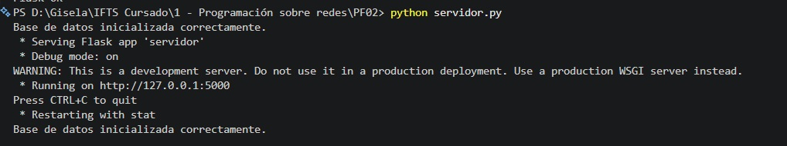

### Registro de usuarios

Registro y validaciones desde el cliente:

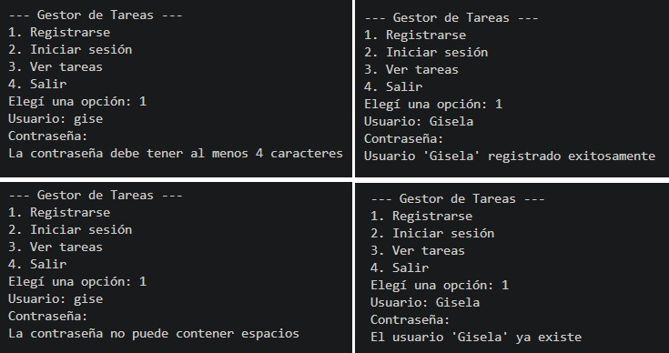

Registro exitoso con curl:

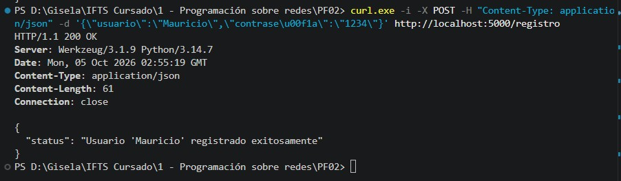

Registro con datos faltantes (400):

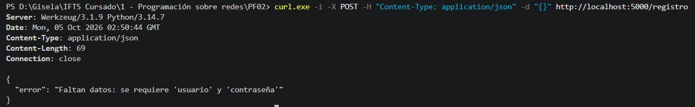

Registro de usuario ya existente (400):

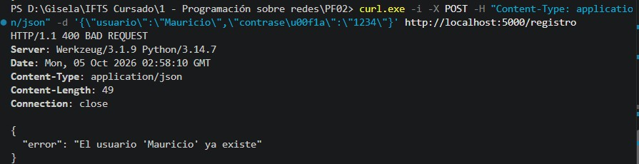

### Inicio de sesión

Inicio de sesión desde el cliente:

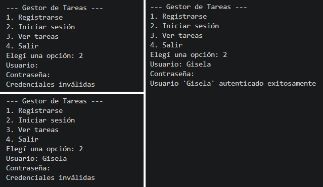

Login exitoso con curl:

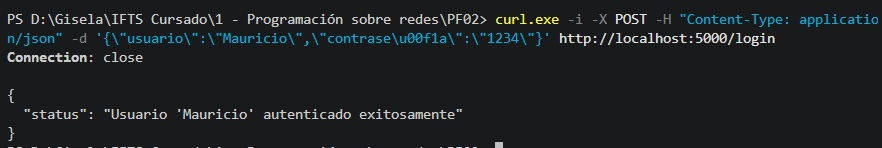

Login con credenciales inválidas (401):

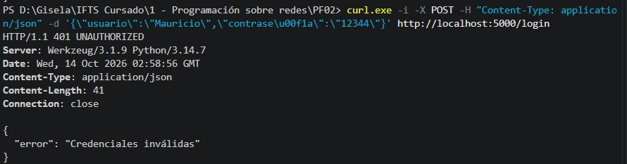

Login con datos faltantes (400):

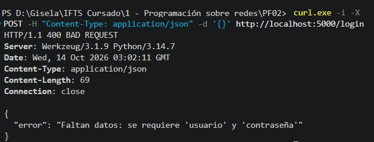

### Ver tareas

Ver tareas desde el cliente:

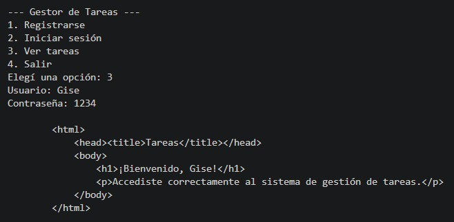

Acceso a tareas por curl (con y sin credenciales):

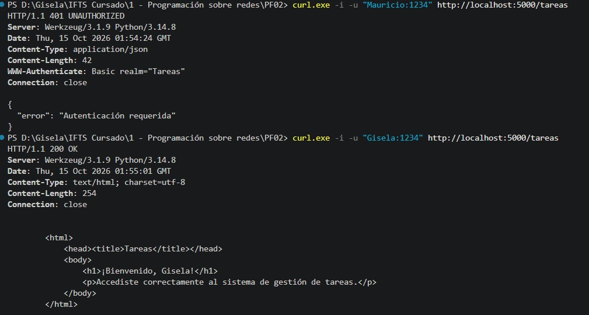

Pedido de autenticación en el navegador:

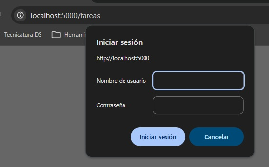

Página de bienvenida tras autenticarse:

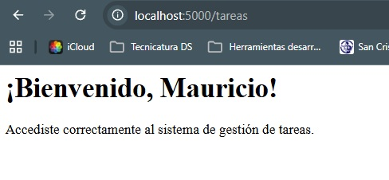

### Registro de pedidos en el servidor

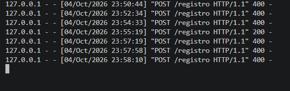

---

## Estructura de la base de datos

Tabla `usuarios`:

| Campo            | Tipo    | Descripción                                |
|------------------|---------|--------------------------------------------|
| id               | INTEGER | Clave primaria autoincremental             |
| nombre_usuario   | TEXT    | Nombre de usuario (único)                  |
| contraseña_hash  | TEXT    | Contraseña hasheada (nunca en texto plano) |

---

## Respuestas conceptuales

### ¿Por qué hashear contraseñas?

Porque al hashear una contraseña no se puede volver a la contraseña original. Esto es importante porque, si las contraseñas se guardaran
en texto plano y alguien lograra acceder a la base de datos, tendría acceso directo a las contraseñas reales de todos los usuarios.

Guardando el hash, aunque la base de datos quede expuesta, las contraseñas siguen protegidas. Para verificar un inicio de sesión no se comparan las
contraseñas directamente, sino sus hashes: se hashea la contraseña ingresada y se compara con el hash guardado.

En este proyecto se usa la librería `werkzeug.security`, con  `generate_password_hash` para guardar y `check_password_hash` para verificar.

### Ventajas de usar SQLite en este proyecto

- **No requiere instalación de un servidor de base de datos aparte:** 
  SQLite guarda todo en un único archivo (`usuarios.db`), lo que simplifica mucho el desarrollo y las pruebas.
- **Viene incluido con Python:** el módulo `sqlite3` es parte de la librería estándar, no hay que instalar nada adicional.
- **Es liviano y suficiente** para un proyecto de este tamaño, donde solo se necesita almacenar usuarios.
- **Persiste los datos:** a diferencia de guardar los usuarios en memoria (que se perderían al apagar el servidor), SQLite los mantiene guardados en el archivo
  entre ejecuciones.

---

## Autor

Gisela Croci - IFTS - Programación sobre Redes